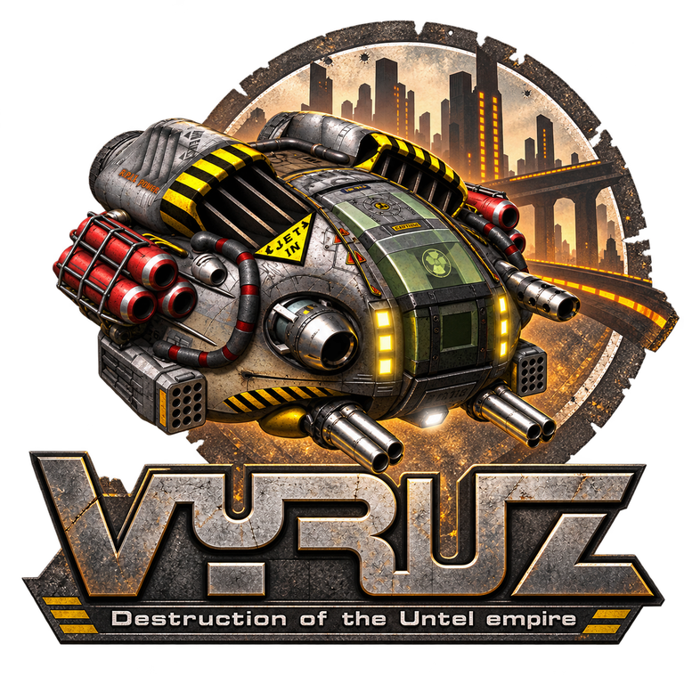

<p align="center"></p>

# OpenVyruz

Native reimplementation of *Vyruz: Destruction of the Untel Empire* (2001, Metropolis Software / C2V) for Windows 11 and Linux (Wayland/X11). It reads the original game data; no game files are included.

The single-player campaign is playable with the intro and menus, and its saves and scores are shared with the original. On top of that come wide screens without stretching, a gamepad, modern audio (distance fade, muffling, zone reverb), a blurred map overlay and modding through `--extract` and `--compress`. The `classic` branch keeps the original's rules.

## Quick start

Prebuilt binaries for Windows and Linux can be downloaded from [Releases](https://github.com/Solessfir/OpenVyruz/releases).

To build it yourself on Windows, with Visual Studio 2026 (the generator fetches the pinned Vulkan SDK itself):

```powershell
git clone --recursive https://github.com/Solessfir/OpenVyruz.git
cd OpenVyruz
.\GenerateProjectFiles.bat vs2026
msbuild Vyruz.slnx /m /t:Vyruz /p:Configuration=Development /p:Platform=x64
```

On Linux, with GCC 14+ or Clang 18+, `slangc`, the Vulkan headers and the Wayland and X11 development packages ([the full list](Docs/Building.md#linux)):

```bash
git clone --recursive https://github.com/Solessfir/OpenVyruz.git
cd OpenVyruz
./GenerateProjectFiles.sh gmake
make config=development Vyruz -j"$(nproc)"
```

Run it with the folder that holds your `vz-data.rsc`; it is remembered for later runs:

```powershell
.\Binaries\windows\Development\Vyruz.exe <path to vz-data.rsc>
```

```bash
./Binaries/linux/Development/Vyruz <path to vz-data.rsc>
```

The Arch package and the other options are in the docs below.

## Docs

- [Building](Docs/Building.md): Windows, Linux, the Arch package and CI
- [Running](Docs/Running.md): the game data, command line, display, controls, settings and saves
- [Tools and checks](Docs/Tools.md): modding, the archive checks and development aids
- [Development](Docs/Development.md): source layout and the original's module map

How the original works, as the port reimplements it:

- [Data formats](Docs/DataFormats.md) of the archives, sprites, levels and sessions
- [Main loop](Docs/MainLoop.md): startup, level loading and the frame loop
- [Player movement](Docs/PlayerMovement.md), the demo replay and the gamepad
- [Combat](Docs/Combat.md): weapons, shots, damage, destruction and difficulty
- [Path search](Docs/PathSearch.md) and the enemies' behaviours
- [Gates and lifts](Docs/GatesAndLifts.md), keys, codes and the ending
- [Surprises](Docs/Surprises.md)
- [HUD](Docs/Hud.md): the panel, radar, map and messages
- [Menus](Docs/Menus.md), options, sessions and Extras
- [Audio](Docs/Audio.md)
- [Intro](Docs/Intro.md) and its Indeo Video 5 decoder
- [Extract and compress](Docs/Extract.md)

## License

Licensed under the [MIT License](LICENSE).
